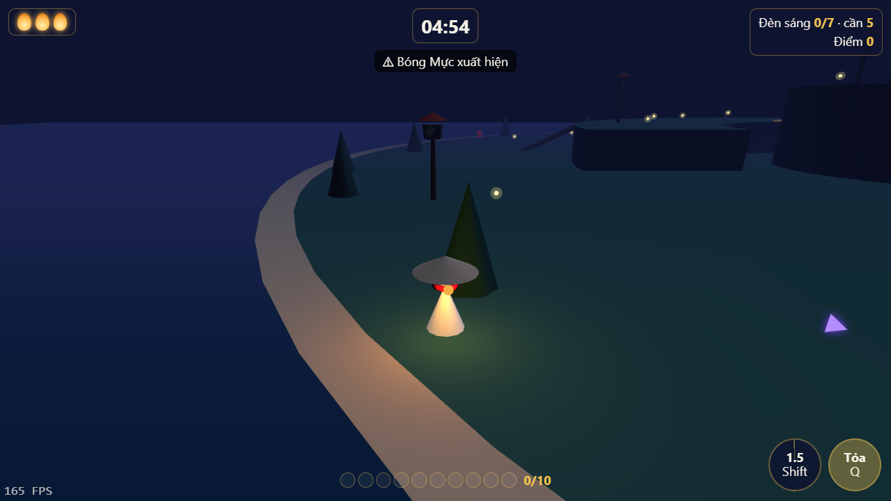

# Đảo Đèn Lồng

> **Video demo:** _(link sẽ được thêm khi quay xong, đính kèm Release v1.0.0)_ · **Phiên bản:** 1.0.0 (Contract v1.3) · [CHANGELOG](CHANGELOG.md) · [ADR](docs/adr/) · [Retro](docs/notes/retro.md) · Đề lab: [docs/lab/](docs/lab/LAB-README.md)

Game 3D góc nhìn thứ ba viết bằng Three.js. Mây, người giữ đèn nhỏ tuổi, gom đom đóm để thắp và **giữ** các Đèn Lồng Lớn sáng tới bình minh trên 3 hòn đảo, đồng thời né Bóng Mực và Gió Lạc. Toàn bộ luật chơi nằm trong một module JS thuần ([src/core/sim.js](src/core/sim.js)). Bản web, chế độ headless, soak test và cảnh benchmark đều dùng chung module đó.



## Yêu cầu hệ thống

- macOS, Linux hoặc Windows, **Node.js ≥ 22**.
- Trình duyệt hỗ trợ WebGL2 (Chrome, Edge, Firefox, Safari mới).
- Lệnh **bench** cần Google Chrome hoặc Chromium. Nếu không tìm thấy, đặt `CHROME=/đường/dẫn/chrome`.
- Không cần GPU cho headless và soak.

## Cài đặt và chạy (3 lệnh)

```bash
git clone <repo> && cd <repo>
npm install
npm start          # mở http://localhost:5173
```

Hoặc dùng bản dựng sẵn trong **Release v1.0.0**: giải nén `dao-den-long-v1.0.0.zip`, chạy `node scripts/serve.js`, không cần `npm install`. Bản đó kèm một `Dockerfile` (`docker build -t dao-den-long . && docker run -p 5173:5173 dao-den-long`).

## Điều khiển (đổi được trong Cài đặt)

| Mặc định | Việc |
|---|---|
| `W A S D` | Đi theo hướng camera |
| Kéo chuột / `← →` | Xoay camera |
| `Space` | Nhảy |
| `Shift` | Lướt (14 m/s, 0,2 s, hồi 1,5 s) |
| `E` | Nạp ánh sáng / châm dầu cho đèn trong 2 m |
| `Q` | Tỏa Sáng (3 đom đóm, choáng Bóng Mực trong 5 m) |
| `P` / `Esc` | Tạm dừng (Esc luôn hoạt động) |
| `F3` | Hiện FPS |

**Cài đặt** (được lưu giữa các lần mở game):
- Âm lượng và độ nhạy chuột.
- **Đổi phím** cho cả 9 hành động, báo khi trùng phím, có nút khôi phục mặc định.
- Bảng màu dễ phân biệt (mù màu).
- **Giảm chuyển động**: tắt rung camera, chớp màn hình và nhấp nháy đồng hồ.
- **Chữ lớn** ×1,25. Chữ giao diện tối thiểu 18 px ở 1280×720.

Game có **phụ đề và chỉ báo hình** cho các sự kiện: Bóng Mực xuất hiện (kèm mũi tên chỉ hướng ở mép màn hình), gió sắp thổi, 10 giây cuối, đèn sắp cạn dầu, đèn tắt.

## Luật chơi

| Đêm | Đảo | Đèn (cần sáng lúc bình minh) | Thời gian |
|---|---|---|---|
| 1 | Đảo Bến | 5 (3) | 240 s |
| 2 | Đảo Cau: 2 đảo, cầu tre, bục nhảy, Gió Lạc, Bùa Gió | 6 (4) | 270 s |
| 3 | Đảo Chuông: 3 tầng, dốc, tháp, gió mạnh | 7 (5) | 300 s |

- Đèn đang sáng mất 1 dầu/giây (tối đa 100). Châm dầu bằng đom đóm, mỗi con = 10 dầu. Dầu < 30 thì đèn mất vùng an toàn 6 m và Bóng Mực tới hút dầu (5/giây mỗi con).
- Hết dầu thì đèn tắt; thắp lại cần 5 đom đóm (lần đầu cần 10).
- Sức chứa bắt đầu ở 10, mỗi lần thắp thành công +2, tối đa 20.
- Có 3 Ngọn Lửa. Bị Bóng Mực chạm thì mất 1 lửa và rơi một nửa số đom đóm đang mang. Rơi khỏi đảo thì mất 1 lửa và toàn bộ đom đóm.

**Điểm:** +5 mỗi đom đóm nạp vào đèn · +100 thắp lần đầu · +40 thắp lại · +5 mỗi Bóng Mực trúng Tỏa Sáng (+15 nếu nó đang hút dầu). Lúc bình minh, nếu thắng: mỗi đèn đang sáng được +50 + floor(dầu), mỗi lửa còn lại +50. Tổng điểm là tổng các Đêm đã thắng.

**Bảng xếp hạng:** sau màn Bình Minh hoặc khi thua, nhập tên (3–12 ký tự chữ, số hoặc `_`; gõ tiếng Việt có dấu được) để lưu. Bảng giữ top 10, mở được từ menu, và lưu ra đĩa ở `data/leaderboard.json`.

## Test, headless, bench, soak

| Việc | Lệnh |
|---|---|
| Test (81) | `npm test` |
| Proof headless (25 scenario) | `npm run proof` → `docs/proof/phase-4/RESULTS.md` |
| Kiểm tra trên Chrome thật (21 bước flow, ảnh, FPS) | `npm run webcheck` |
| Headless (Contract v1.3) | `node src/headless.js --seed 1 --night <1\|2\|3> --ticks 600 --out out.jsonl [--scenario f.json] [--inputs f.json] [--snapshot-every 10]` |
| **Bench** | `node scripts/bench.js --seed 42 --duration 30 --out bench.json` |
| **Soak** | `node --expose-gc scripts/soak.js --seed 7 --nights 10 --out soak.json` |
| Xuất bảng xếp hạng | `node scripts/serve.js --export-leaderboard out.json` |
| Gói Release | `node scripts/package.js` → `dist/dao-den-long-v1.0.0.zip` |

- **Bench:** mở cửa sổ Chrome 1280×720 với vsync tắt (`--disable-gpu-vsync --disable-frame-rate-limit`), chạy cảnh chuẩn (Đêm 1, 200 Bóng Mực, 100 đom đóm, camera bay vòng), khởi động 3 s, đo 30 s rồi thoát với mã 0. `peak_mem_mb` là tổng RSS của cây tiến trình Chrome. Thêm `--headless` để chạy không cửa sổ (chỉ dùng tham khảo).
- **Soak:** 10 Đêm trong một tiến trình (Đêm 1 → 2 → 3 xoay vòng). Đêm thứ i (đếm từ 0) dùng seed 7 + i, input ngẫu nhiên theo seed.

## Bằng chứng

| Phase | Kết quả | Chi tiết |
|---|---|---|
| 1 | 25/25 test, 7/7 scenario | [docs/proof/phase-1/](docs/proof/phase-1/README.md) |
| 2 | 54/54 test, 20/20 scenario, 11/11 flow | [docs/proof/phase-2/](docs/proof/phase-2/README.md) |
| 3 | 70/70 test, 25/25 scenario, 11/11 flow | [docs/proof/phase-3/](docs/proof/phase-3/README.md) |
| 4 | 81/81 test, 25/25 scenario, 21/21 flow, **bench 333,8 FPS / 1 % low 136,5 / load 641 ms**, **soak 0 crash, RSS ×1,11** | [docs/proof/phase-4/](docs/proof/phase-4/README.md) |

## Sáng tạo của tôi

Tất cả nằm ở lớp hiển thị ([web/](web/)), không đụng vào luật trong `src/core`, nên output headless không đổi. Trong cảnh bench, âm thanh, phụ đề và hiệu ứng chớp đều tắt.

- **Đảo sáng dần:** sương tan bớt theo số đèn đang sáng. Đèn chưa thắp ấm dần theo lượng ánh sáng đã nạp.
- **Ông Đăng** dẫn chuyện ở màn giới thiệu mỗi Đêm.
- **Âm thanh tổng hợp bằng WebAudio** (không dùng file asset): nhạc nền ngũ cung, tiếng gió dùng nhiễu lọc.
- Gió Lạc là dải lụa uốn lượn, và hiện đốm sáng khi đang giữ đom đóm vừa cướp.
- Rung camera và chớp màn hình khi bị chạm hoặc khi Tỏa Sáng (tắt được bằng "Giảm chuyển động").

Bằng chứng phần lõi vẫn đúng: `grep -rnE "^import .*web/" src/` không ra kết quả, proof 25/25 và test 81/81.

## Harness AI

| Thành phần | Dùng khi |
|---|---|
| [AGENTS.md](AGENTS.md) (CLAUDE.md import lại) | Mọi phiên: lệnh, cấu trúc, thứ tự tick, quy tắc test và mutation |
| [.claude/skills/verify](.claude/skills/verify/SKILL.md) | Sau khi đổi luật, bản đồ, CLI hoặc UI; trước khi gắn tag |
| [Stop hook](.claude/settings.json) → [scripts/stop-gate.js](scripts/stop-gate.js) | Tự động: chặn agent kết thúc khi `npm test` đỏ |
| [scripts/webcheck.js](scripts/webcheck.js) | Agent tự chơi trong Chrome thật: ảnh, 21 bước flow, FPS |
| [CI](.github/workflows/ci.yml) | Mỗi lần push: test, proof, kiểm tra output tất định trên Linux và macOS |

Bản quyền: [LICENSE](LICENSE) (MIT) · Nguồn asset và công cụ: [CREDITS.md](CREDITS.md)
